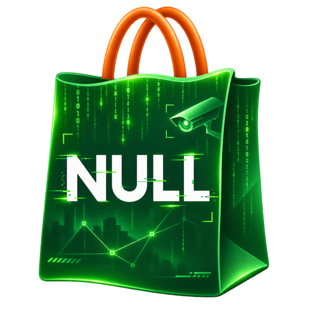
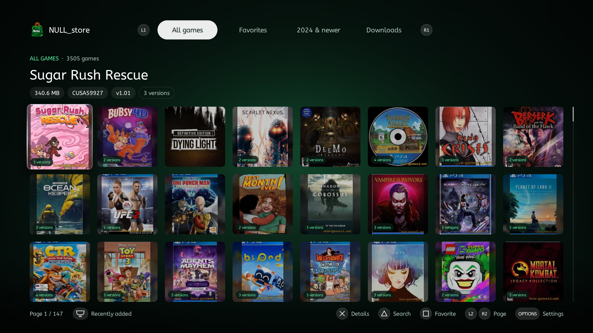
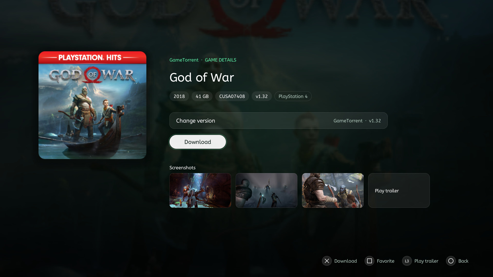
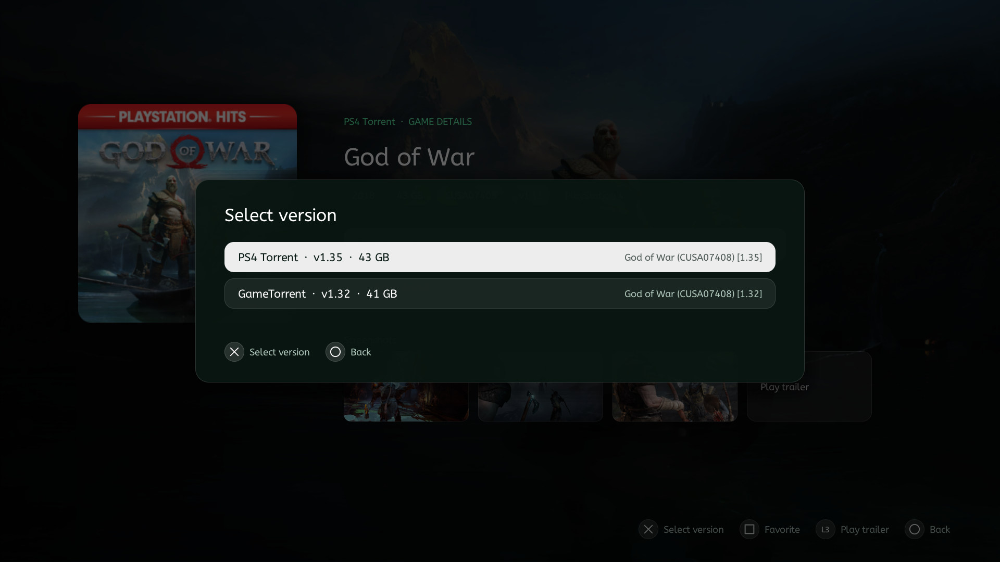
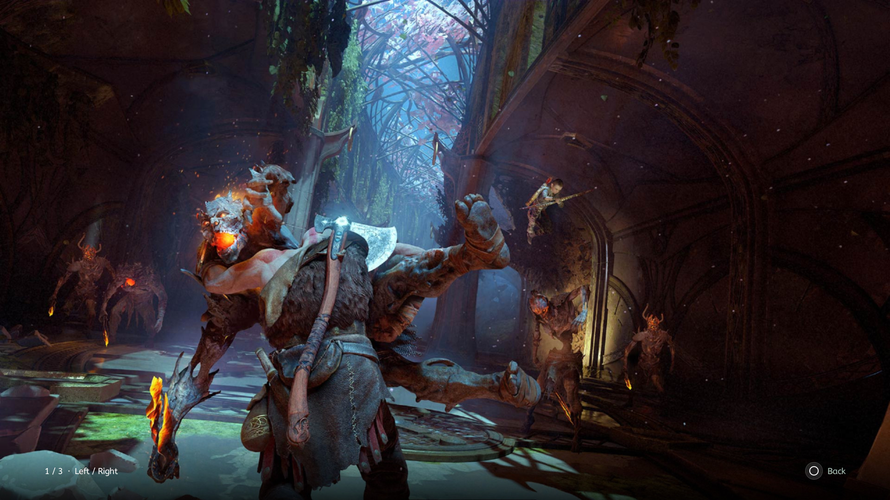
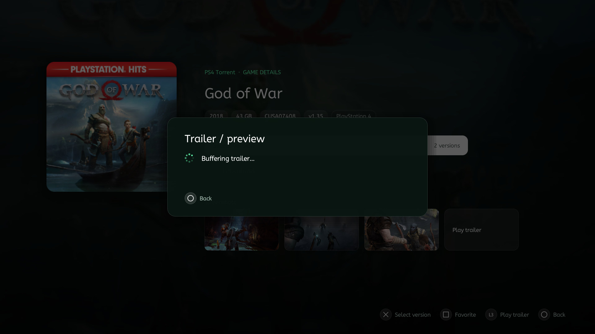
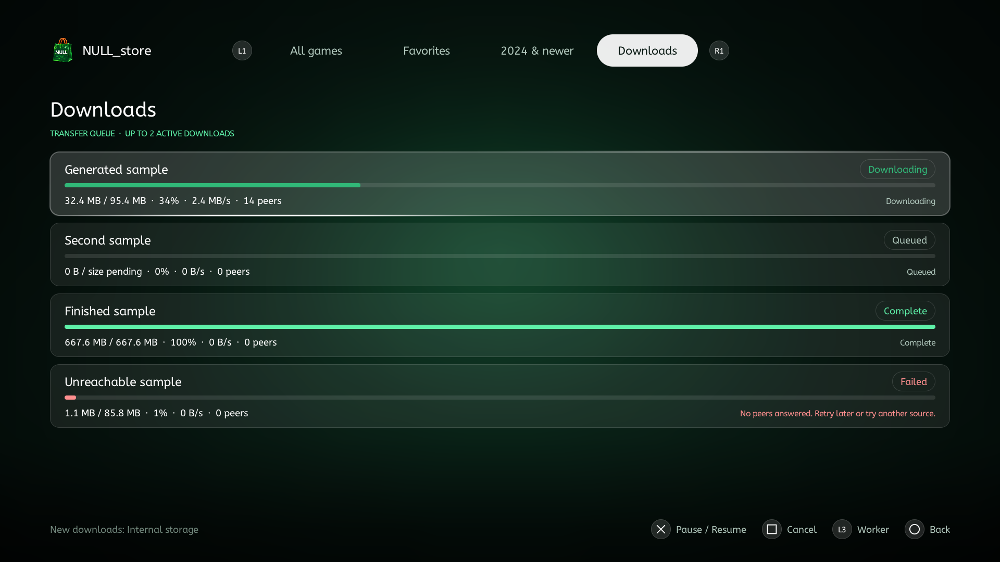
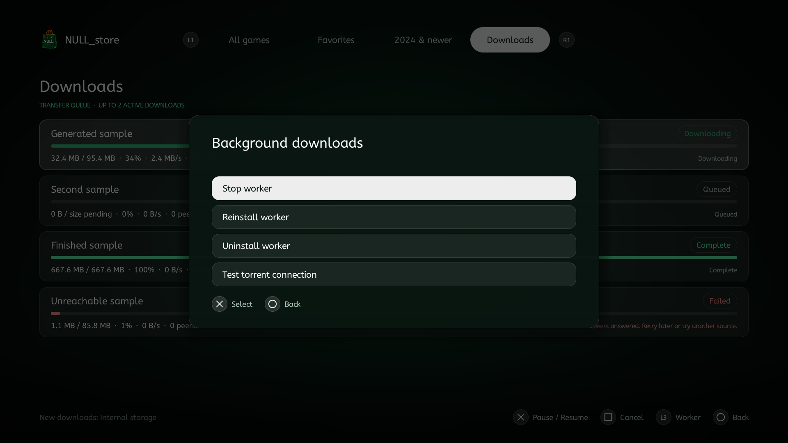

  
  <h1>NULL_store</h1>
  
<strong>PS4 homebrew game catalogue and BitTorrent download manager for HEN-enabled consoles.</strong>

  
Browse game listings, queue torrent downloads, install compatible PKG files, or keep transfers running with the optional background service.

  
YOUR SYSTEM. YOUR RULES.

  

    
    
    
    
  

## Video walkthrough

The video shows an earlier interface. The screenshots and controls below follow the current game page.

## Browse and download a game

Install the **NULL_store** PKG from [Releases](../../releases/latest) with HEN active, then open the store from the PS4 home screen.

1. In the catalogue, highlight a game and press **X**. Press **Triangle** to search, enter a title and confirm on the keyboard. **L2 / R2** turn pages and the **touchpad** changes the sort order. **Square** saves or removes a favorite.
2. If a game has several listings, open **Select version**. Compare the source, version and size where available. Use **Up / Down** and press **X** to select one. You return to the game page with **Download** highlighted. You can still pick **Change version**.
3. Press **X** on **Download**. The store checks the source. A single torrent goes straight into the queue. If the source offers several files, highlight the one you want and press **X** to add it.
4. Once queued, **Go to downloads** opens that transfer. You can also use **L1 / R1** to reach the **Downloads** tab from the catalogue.

See the version picker

### Screenshots and trailers

To load official media, press **Options** in the catalogue and enable **Official artwork**. Press **Down** to reach the thumbnails, choose one with **Left / Right** and press **X** for fullscreen. **Left / Right** browse the screenshots and **Circle** returns to the game page.

Select **Play trailer** and press **X**, or press **L3** on the game page. On servers that support streaming, the player buffers a few seconds before starting and keeps fetching ahead during playback. If the connection slows, the player refills its buffer before resuming. Press **Circle** to stop playback and further requests. A server that requires a full download gets a separate loading message. If the PS4 cannot open or play a linked preview, the QR code lets you try the same link on your phone. Games without a trailer link have no trailer action.

See the fullscreen viewer and trailer loading screen

## Manage downloads

| In Downloads | Control |
| --- | --- |
| Pause or resume the highlighted transfer | **X** |
| Remove a transfer and choose whether to keep its files | **Square** |
| Install a package from a completed transfer | **Triangle**, select a compatible `.pkg`, then **X** |
| Manage the background worker | **L3** |

**To change where future downloads go**, open **Options → Download location** from the catalogue. Choose a drive, open a folder and select the current folder. Existing transfers keep their original locations.

**To install a game**, download the base package first, then its updates or DLC. Archives and split packages need extracting or joining first. The PS4 reports the installation result in Notifications. On some consoles the status goes directly from **Installing** to **Installed**.

### Keep downloads running after closing the store

1. Open **Downloads → L3 → Install included worker**. Confirm installation and wait for it to finish.
2. Open **Downloads → L3 → Start worker**. Once the menu offers **Stop worker**, you can close NULL_store and leave the PS4 awake with HEN active.
3. To switch back to downloading in the open store, choose **Stop worker**. **Uninstall worker** removes the worker and keeps the queue and downloaded files.

Start the worker from the store after a reboot. Transfers require the PS4 to stay awake.

## Catalogue sources and settings

PS4 Torrent, GameTorrent and Love Games are ready on first launch. The store opens a bundled catalogue and refreshes listings from those sites in the background. **Options → Refresh catalogue** starts a manual refresh. **Options → Catalog source** lets you filter by site, press **Square** to switch between grouped and separate listings, or scan a QR code to add a source from your phone. You can also import [sources.json from USB](SOURCES.md).

The store uses **BitTorrent** to download games from peers. Speed depends on which peers are reachable. If you use Real-Debrid, AllDebrid, Premiumize, TorBox or Debrid-Link, choose the service in **Settings** and enter your own API key. NULL_store can then send the torrent to the service and fetch the resulting files over HTTPS.

The interface supports English, Brazilian Portuguese, Spanish, Turkish, French and Italian. [PS4 test guide](TESTING.md)

## Known limitations and test status

- The store groups matching listings. Titles with different names and no shared title ID can still appear separately.
- Transfers can be slow or fail when trackers are unavailable or no compatible peers can be reached.
- Package installation supports complete compatible `.pkg` files; it does not extract archives or join split packages.
- The Background Service requires HEN to remain active and the console to stay awake. Rest mode and automatic startup are not supported.
- PS4 may not report install percentages; check Notifications for the final system result.

Console testing has been performed on PS4 system software **13.00** with HEN active. The exact HEN/GoldHEN build was not recorded, and other firmware/HEN combinations have not been verified. Catalogue browsing, foreground transfers, and in-app PKG installation have been tried on-console. The Background Service's close-app behavior still needs further testing across console setups.

## Frequently asked questions

### Where do I install the download worker?

The store package includes the worker. Install and start it from **Downloads → L3** to continue a transfer after closing the store. Foreground downloads work with the store alone.

## Disclaimer

NULL_store is a BitTorrent client for listings from third-party sites. This project publishes the app and its optional background service; it does not host, store, or distribute game files through this repository or a NULL_store server.

The app saves downloads on your PS4 and may upload pieces of those files to other BitTorrent peers during a transfer. Check your local laws and only download or share content you have permission to use.

## Source and building

The source code and host tests are available in this repository. See [BUILDING.md](BUILDING.md) for build requirements, [ROADMAP.md](ROADMAP.md) for planned improvements, and [CONTRIBUTING.md](CONTRIBUTING.md) to get involved. NULL_store is released under [GPL-3.0](LICENSE). Third-party components retain their respective licenses.

## Thanks

Special thanks to Phoenixx1202 for the Piglet storefront redesign, grouped game listings, Debrid support and translations. [Storefront redesign PR](https://github.com/lastrowcritic/null-store-ps4/pull/6)

Thanks to notnameddev for phone-based catalogue setup, and to everyone who tested builds and reported issues. [Phone setup PR](https://github.com/lastrowcritic/null-store-ps4/pull/5)

## Third-party software

Trailer playback uses [FFmpeg 8.1.3](https://ffmpeg.org/releases/ffmpeg-8.1.3.tar.xz) for H.264 video and AAC audio. The package includes the [LGPL notice](assets/licenses/FFmpeg-LGPL-2.1.txt).

The store renders with the precompiled Piglet shader binaries of the SDL2 PS4 port by cpasjuste, under the zlib license ([notice](third_party/piglet_shaders/LICENSE-SDL.txt)), and uses the public-domain [stb](third_party/stb/LICENSE) libraries for images and fonts. WebP artwork is decoded with [libwebp](third_party/libwebp/README.nullstore.txt) 1.4.0, under its [BSD license](third_party/libwebp/COPYING). Letters the store's ABeeZee font lacks (Turkish ğ, ş, İ) come from the Inter font, under the SIL Open Font License ([license](assets/LICENSE-font-fallback.txt)).

[Latest release checksums](../../releases/latest/download/SHA256SUMS.txt)
